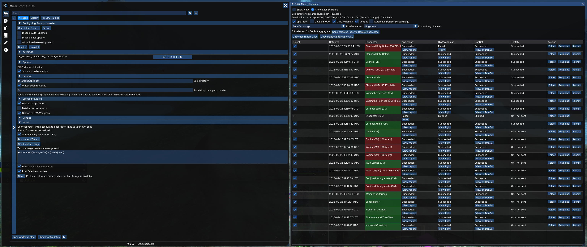
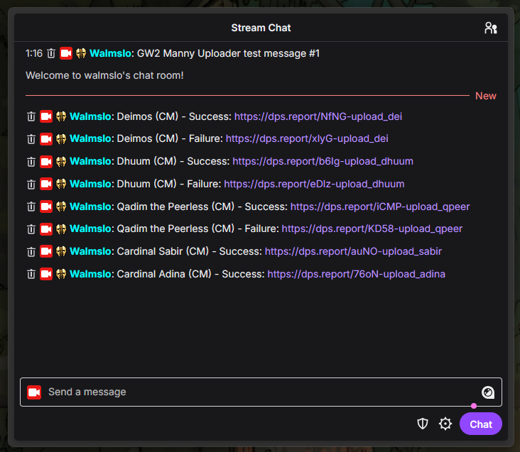

# GW2 Manny Uploader

Automatically upload arcdps logs to dps.report, GW2Wingman, and DonBot, and post report links to your Twitch chat. Supports Windows and Wine/Proton.

## Install

Requires [Raidcore Nexus](https://raidcore.gg/gw2/nexus) and arcdps saving compressed `.zevtc` logs.

1. Download the Windows x64 ZIP from the [latest release](https://github.com/LoganWal/GW2-MannyUploader/releases/latest).
2. Extract `manny_uploader.dll` into `<Guild Wars 2>\addons\`.
3. Launch the game, enable MannyUploader in Nexus, and choose destinations in Nexus options > MannyUploader.

Nexus checks GitHub Releases for updates and reloads the addon when possible.

## Use

Open the list from the quick-access icon or Alt+Shift+M.

- Log folder: defaults to `<Guild Wars 2>\arcdps.cbtlogs`. Change it in options if needed.
- Show New: watches logs completed after the addon loads. Show Last 24 Hours: includes the previous day's logs.
- Copy links: copy dps.report URLs or one DonBot aggregate URL for selected fights.
- Reupload / Rechat: explicitly resend a log or Twitch message. Upload history prevents automatic repeats across restarts.



## Connect destinations

- dps.report / GW2Wingman: enabled by default. Toggle them in the list or options.
- DonBot: select DonBot, enter your GW2 API key, select Verify DonBot, and choose an authorized server. Auto post to Discord is optional.
- Twitch: select Connect Twitch to open authorization, authorize your broadcaster account, then select Twitch to post report links. Requires dps.report. Keep the authorization browser window off stream.

With dps.report enabled, the other destinations wait for its link. Without it, Wingman and DonBot upload directly.



Credentials use protected storage. Wine provides weaker protection, flagged in options. Disconnect DonBot and Twitch before permanently removing the addon.

## Troubleshooting

- Missing logs: check the log folder, subdirectory option, and that arcdps saves `.zevtc` files.
- Addon missing: check that `manny_uploader.dll` is directly inside the game's `addons` folder.
- Upload failed: check the row's status and use the offered retry.
- [Report an issue](https://github.com/LoganWal/GW2-MannyUploader/issues) with versions, status text, and reproduction steps. Leave out credentials and private data.

## Development

Requires stable Rust and CMake 3.30+. The addon builds for Windows x64 with MSVC.

```sh
cargo test --locked -p manny-uploader
cargo build --locked -p manny-uploader-addon --release --target x86_64-pc-windows-msvc
```

The **Build DLL** action provides one verified MSVC DLL for development. The manual **Release validation** workflow runs the full native release checks. Native in-game validation remains required before a public release.
After those checks, **Publish Nexus release** can publish the verified DLL and ZIP from that exact validation run.
See [Rust development](rust/README.md) for build and lifecycle details.

[Architecture](docs/architecture/overview.md) | [Behavior contracts](docs/contracts/README.md) | [Windows validation](docs/release/native-windows-validation.md) | [Release evidence](docs/release/evidence-template.md) | [Third-party licenses](THIRD_PARTY_NOTICES.md)
